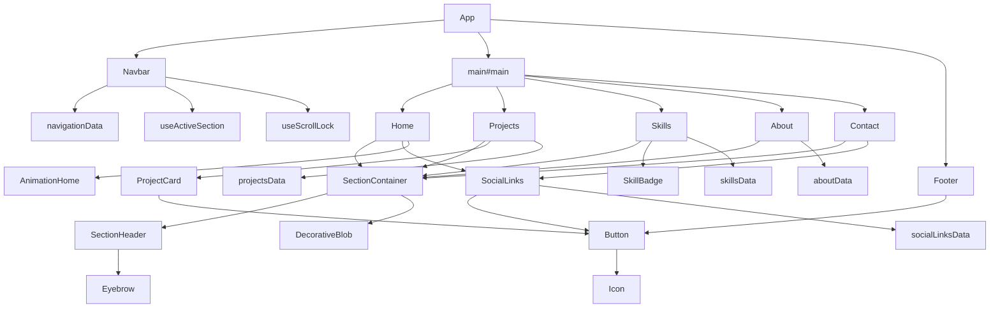

# PLAN_REFACTOR.md — Plan Maestro de Refactorización (Portfolio SPA)

> **Autor:** Principal Frontend Architect (auditoría en modo solo lectura)
> **Fecha:** 2026-11-04
> **Stack auditado:** React 18.3 · Vite 7 · Tailwind CSS 3.4 · `@catppuccin/tailwindcss` 0.1.6 · `lottie-web` 5.12 · `react-lottie` 1.2.4 · `react-scroll` 1.9
> **Destinatario:** modelo constructor. Ejecuta las fases **en orden**. No improvises clases ni nombres: todo lo necesario está aquí.

---

## 0. Reglas globales para el modelo constructor

1. **Shell Windows/PowerShell:** `npm.ps1` está bloqueado por la Execution Policy. Usa SIEMPRE `npm.cmd` (ej.: `npm.cmd ci`, `npm.cmd run build`).
2. **Node:** Vite 7 exige Node `>=20.19` o `>=22.12`. Verifícalo con `node -v` antes de empezar.
3. `node_modules/` **no está instalado** actualmente → el primer comando es `npm.cmd ci`.
4. **No instales librerías nuevas** (ni iconos, ni `clsx`, ni `framer-motion`). La única operación sobre `package.json` es: declarar `prop-types` (ya está en el lockfile) y desinstalar `react-lottie` + `react-scroll` al final.
5. **Tailwind JIT:** NUNCA construyas clases con interpolación (`text-${color}-400`). Todas las variantes de color viven como strings literales en `src/data/accentStyles.js`.
6. **ESLint** (`.eslintrc.cjs`) usa `plugin:react/recommended` → la regla `react/prop-types` está activa y el script `lint` usa `--max-warnings 0`. **Todo componente con props debe declarar `propTypes`** (incluido `children: PropTypes.node`).
7. **Imports:** extensión explícita siempre (`.jsx` para componentes, `.js` para data/hooks/utils), rutas relativas.
8. Atributos SVG en JSX siempre en camelCase (`fillRule`, `clipRule`, `strokeWidth`, `strokeLinecap`).
9. Estrategia **strangler**: se crean los archivos nuevos en paralelo, `App.jsx` se conmuta al final de la Fase C y los antiguos se borran en la Fase D. La app debe compilar al final de cada fase.

---

## 1. AUDITORÍA Y DIAGNÓSTICO DEL ESTADO ACTUAL

### 1.1 `Navbar.jsx` — por qué se rompe en móvil

Archivo: [Navbar.jsx](file:///c:/ws/my-portfolio/src/components/Navbar.jsx)

| # | Problema | Evidencia | Efecto |
|---|----------|-----------|--------|
| N1 | **Ancho mínimo intrínseco ≈ 506 px sin breakpoints.** El `<ul>` es `flex` sin `flex-wrap`, cada link es `whitespace-nowrap`, `gap-8` (4×32 = 128 px) + `px-8` (64 px) + ~312 px de texto `text-sm` + borde. El min-content de un flex de una sola línea es la suma de sus items. | [L13-L15](file:///c:/ws/my-portfolio/src/components/Navbar.jsx#L13-L15), [L22](file:///c:/ws/my-portfolio/src/components/Navbar.jsx#L22) | En viewports < ~506 px la píldora es más ancha que la pantalla. |
| N2 | **Centrado con `left-1/2 -translate-x-1/2`** sobre una caja más ancha que el viewport. | [L13](file:///c:/ws/my-portfolio/src/components/Navbar.jsx#L13) | En 320 px la caja va de x≈−93 px a x≈413 px: "Inicio" y "Contacto" quedan **cortados por ambos lados**; la parte izquierda es inalcanzable y en Safari iOS/Chrome Android puede generar paneo lateral del visual viewport. |
| N3 | **No existe menú móvil:** sin estado `isOpen`, sin botón hamburguesa, sin ninguna clase `sm:`/`md:`. | Archivo completo | Imposible adaptar la navegación. |
| N4 | **`react-scroll` `<Link>` renderiza `<a>` SIN `href`** (verificado en `react-scroll/modules/mixins/scroll-link.js`). | [L18-L26](file:///c:/ws/my-portfolio/src/components/Navbar.jsx#L18-L26) | Links no enfocables con teclado (Tab), sin URL `#ancla`, sin deep-linking, sin semántica. |
| N5 | **Sin offset para la barra fija:** `Link` sin prop `offset` y las secciones sin `scroll-margin-top`. | [L18-L21](file:///c:/ws/my-portfolio/src/components/Navbar.jsx#L18-L21) | Al navegar, la barra flotante tapa el inicio de la sección. |
| N6 | **Targets táctiles < 44 px:** links `text-sm` sin padding vertical (~20 px de alto). | [L22](file:///c:/ws/my-portfolio/src/components/Navbar.jsx#L22) | Incumple WCAG 2.5.5 / guías táctiles de Apple y Material. |
| N7 | Estados solo `hover:` (subrayado `group-hover:w-full`), sin `focus-visible` ni estado activo. | [L25](file:///c:/ws/my-portfolio/src/components/Navbar.jsx#L25) | En táctil no hay feedback; en teclado no hay foco visible. |
| N8 | `top-6` + alto ~52 px = 76 px de ocupación, pero `Home` usa `lg:py-16` (64 px). | [Home.jsx L10](file:///c:/ws/my-portfolio/src/components/Home.jsx#L10) | En `lg` la píldora se solapa con el contenido superior del hero. |
| N9 | `<nav>` sin `aria-label`; datos de navegación hardcodeados dentro del componente. | [L4-L10](file:///c:/ws/my-portfolio/src/components/Navbar.jsx#L4-L10) | Accesibilidad y mantenibilidad. |

### 1.2 Overflow y problemas de escala por componente (320 px → escritorio)

> **Hallazgo transversal crítico (afecta a TODAS las secciones):**
> - **T1 — Blob decorativo nunca se renderiza:** `aspect-[1404,767]` es un valor arbitrario inválido (coma en vez de `/`) → genera `aspect-ratio: 1404,767`, el navegador lo descarta, el div no tiene contenido → **altura 0**. Presente en [Home L68](file:///c:/ws/my-portfolio/src/components/Home.jsx#L68), [About L83](file:///c:/ws/my-portfolio/src/components/About.jsx#L83), [Skills L139](file:///c:/ws/my-portfolio/src/components/Skills.jsx#L139), [Projects L142](file:///c:/ws/my-portfolio/src/components/Projects.jsx#L142), [Contact L265](file:///c:/ws/my-portfolio/src/components/Contact.jsx#L265).
> - **T2 — Capas `-z-10` invisibles:** las `<section>` y tarjetas son `relative` **sin** `z-index` → no crean stacking context. Los hijos `absolute -z-10` (blob y overlays de hover `group-hover:opacity-10`) se pintan en el stacking context raíz, **debajo** del `bg-base` del wrapper `<Element>`. Resultado: los overlays de hover de las tarjetas de About/Skills/Contact no se ven nunca. **Fix:** añadir `isolate` al contenedor.
> - **T3 — `overflow-hidden` en cada `<section>`** es lo que impide que el blob de `w-[87.75rem]` (1404 px) desborde. Es una dependencia oculta: se mantiene, pero centralizada en `SectionContainer`.
> - **T4 — `<Element name="...">` de react-scroll** renderiza `<div name="home">`: atributo inválido en `div`, sin `id` → `#home` no funciona como URL.
> - **T5 — `<body>` sin fondo:** el fondo depende de cada wrapper `bg-base`; en overscroll (iOS rubber-band) se ve blanco.

| Componente | Problema | Evidencia | Severidad |
|------------|----------|-----------|-----------|
| **Navbar** | Única fuente real de **overflow horizontal a nivel de página** (ver N1/N2). | — | 🔴 Crítico |
| **AnimationHome** | `height={750}` fijo en px dentro de un contenedor `max-w-md` (448 px) con `preserveAspectRatio: "xMidYMid slice"` → la animación 1600×1600 se **recorta lateralmente** y fuerza una fila de 750 px (más alta que un laptop 1366×768). | [AnimationHome L10-L14](file:///c:/ws/my-portfolio/src/components/AnimationHome.jsx#L10-L14) | 🔴 |
| **AnimationHome** | `react-lottie` ignora la prop `className`; renderiza `<div role="button" tabIndex="0">` con click-to-pause (trampa de foco / anuncio erróneo en lectores de pantalla); usa `componentWillUpdate` (warning en StrictMode). | `react-lottie/dist/index.js` | 🟠 |
| **AnimationHome** | Importación **estática** del JSON de 578 KB → va al bundle principal y penaliza LCP en móvil, aunque en móvil la animación está oculta. | [AnimationHome L2](file:///c:/ws/my-portfolio/src/components/AnimationHome.jsx#L2) | 🟠 |
| **Home** | Animación `hidden lg:flex`: oculta < 1024 px **pero sigue montada** (Lottie corre su loop rAF con `display:none` → CPU/batería). | [Home L56](file:///c:/ws/my-portfolio/src/components/Home.jsx#L56) | 🟠 |
| **Home / buttons** | Botones con ancho fijo `w-32` (128 px) + `mt-4` dentro de un flex con `gap-4` → "LinkedIn" (icono 24 + gap 4 + ~70 px texto bold + 32 px padding ≈ 130 px) queda al límite/desborda; `mt-4` + `gap-4` desalinea al hacer wrap. Alto ≈ 40 px (< 44 px). | [GithubButton L6](file:///c:/ws/my-portfolio/src/components/buttons/GithubButton.jsx#L6) (idéntico en los 3) | 🟠 |
| **buttons/** | `fill-rule`/`clip-rule` en JSX → warning React y error ESLint `react/no-unknown-property`; icono `text-gray-800 dark:text-white` (Tailwind `darkMode: 'media'`) → icono gris oscuro sobre rosa si el SO está en modo claro; `target="_blank"` sin `rel`; 3 archivos 95 % duplicados. | [GithubButton L9-L20](file:///c:/ws/my-portfolio/src/components/buttons/GithubButton.jsx#L9-L20) | 🟠 |
| **Skills** | **Grid anidado que colapsa entre 768 px y ~1200 px:** exterior `md:grid-cols-3 gap-12` + interior `sm:grid-cols-3 gap-4`. En 768 px: columna exterior ≈ 208 px → tarjeta ≈ 58 px − `p-4` = **26 px útiles para un icono `w-12` (48 px)**. Como la tarjeta tiene `overflow-hidden`, iconos y labels ("JavaScript", "Tailwind CSS") quedan **recortados**. En 1024 px quedan ≈ 53 px útiles (labels cortados). | [Skills L62-L72](file:///c:/ws/my-portfolio/src/components/Skills.jsx#L62-L72), [L117](file:///c:/ws/my-portfolio/src/components/Skills.jsx#L117) | 🔴 |
| **Skills** | Columnas desbalanceadas (17 / 3 / 2 items); `key={index}`; typo "Expertiz"; `prop-types` importado pero **no declarado** en `package.json`; `next.svg` (#212121) y `express.svg` (negro) serían invisibles sobre fondo oscuro; `next.svg` no se usa. | [Skills L2](file:///c:/ws/my-portfolio/src/components/Skills.jsx#L2), [L106](file:///c:/ws/my-portfolio/src/components/Skills.jsx#L106) | 🟠 |
| **Projects** | Alturas fijas `h-48 sm:h-56` en lugar de `aspect-video` → distorsión de encuadre según ancho. | [Projects L65](file:///c:/ws/my-portfolio/src/components/Projects.jsx#L65) | 🟠 |
| **Projects** | Botón "Ver sitio" **solo visible en hover** (`opacity-0 group-hover:opacity-100`) → inaccesible en táctil; usa `<button onClick={window.open(...)}>` sin `noopener` (reverse tabnabbing); links deshabilitados con `pointer-events-none` siguen siendo enfocables por teclado; link siempre rotulado "Frontend" aunque el proyecto tenga un único repo; URLs placeholder falsas (`github.com/username/...`); `` sin `width/height/loading` (CLS). | [Projects L80-L129](file:///c:/ws/my-portfolio/src/components/Projects.jsx#L80-L129) | 🟠 |
| **About** | `p-8` fijo en 320 px deja 224 px de ancho de texto con `leading-8` (muy denso); `sm:text-5xl lg:text-5xl` redundante; overlays de hover invisibles (T2). | [About L27](file:///c:/ws/my-portfolio/src/components/About.jsx#L27) | 🟡 |
| **Contact** | `p-8` fijo; formulario sin `noValidate` (popups nativos de `type="email"` compiten con la validación propia); inputs sin `autoComplete`, `aria-invalid`, `aria-describedby`; no hay canales directos (LinkedIn/GitHub) en la sección de contacto; envío **simulado** con `setTimeout`. | [Contact L65-L71](file:///c:/ws/my-portfolio/src/components/Contact.jsx#L65-L71), [L125](file:///c:/ws/my-portfolio/src/components/Contact.jsx#L125) | 🟡 |
| **main.jsx** | `import React, {StrictMode}` → `React` sin uso → error `no-unused-vars` con `--max-warnings 0`. | [main.jsx L1](file:///c:/ws/my-portfolio/src/main.jsx#L1) | 🟡 |
| **App.jsx** | Sin landmarks `<main>`/`<footer>`; sin skip-link. | [App.jsx](file:///c:/ws/my-portfolio/src/App.jsx) | 🟡 |

### 1.3 Dependencias — qué se reutiliza y qué sobra

| Paquete | Estado | Decisión | Motivo |
|---------|--------|----------|--------|
| `react`, `react-dom` 18.3 | dependencies | ✅ Mantener | — |
| `lottie-web` ^5.12.2 | dependencies (directa) | ✅ **Reutilizar directamente** vía `lottie-web/build/player/lottie_light` (import dinámico) | Ya instalada. El JSON no usa expressions (0 coincidencias de `"x":"`), ni imágenes, ni capas de texto → el build *light* (solo SVG, sin `eval`) es suficiente y más pequeño. `lottie-web` 5.12.2 no define `exports`, el subpath es importable. |
| `react-lottie` ^1.2.4 | dependencies | ❌ **Eliminar (Fase D)** | Abandonado (2018), `componentWillUpdate`, `role="button"` + `tabIndex=0` + click-to-pause, arrastra `babel-runtime@6`. |
| `react-scroll` ^1.9.0 | dependencies | ❌ **Eliminar (Fase D)** | Sustituido por anclas nativas `href="#id"` + `scroll-behavior: smooth` + `scroll-mt-16` + `scrollIntoView`. Su `Link` no genera `href` (no accesible). |
| `prop-types` 15.8.1 | **Solo transitiva** (lockfile) pero importada en `Skills.jsx` | ➕ **Declarar explícitamente** (`npm.cmd install prop-types@^15.8.1`) | Ya existe en el árbol (no descarga nada nuevo). Necesaria para la regla `react/prop-types`; tras quitar `react-scroll` dejaría de estar garantizada en producción. |
| `@catppuccin/tailwindcss` 0.1.6 | devDependencies | ✅ Mantener | Aporta `bg-base`, `text-text`, etc. vía variables `--ctp-*` (flavour `mocha` en `:root`). Hace **merge** con la paleta Tailwind: `pink.DEFAULT` = Catppuccin, `pink-400` = Tailwind → las clases actuales `*-pink-400/500` siguen funcionando. Soporta modificador de opacidad (`bg-base/80`). |
| Librería de iconos | **No hay ninguna** | ✅ Usar SVG inline en `ui/Icon.jsx` | Reutilizar los `path` existentes de `buttons/`. No instalar `react-icons`/`lucide`. |
| `clsx` / `classnames` | No hay | ✅ Helper propio `utils/cn.js` (1 línea) | Evitar dependencia. |
| Animaciones (framer, etc.) | No hay | ✅ Transiciones CSS de Tailwind (`transition-*`, `motion-safe:`) | — |

---

## 2. DISEÑO DE LA NUEVA ARQUITECTURA SPA

### 2.0 Árbol de archivos objetivo

```text
src/
├── main.jsx                          (MODIFICAR – import sin React)
├── App.jsx                           (REESCRIBIR)
├── index.css                         (REESCRIBIR)
├── assets/                           (SIN CAMBIOS)
│   ├── animations/animationHome.json
│   ├── icons/*.svg                   (22 iconos de skills + favicon.svg)
│   └── img/minga.jpg                 (1900×914)
├── data/
│   ├── navigationData.js             (NUEVO)
│   ├── socialLinksData.js            (NUEVO)
│   ├── skillsData.js                 (NUEVO)
│   ├── projectsData.js               (NUEVO)
│   ├── aboutData.js                  (NUEVO – extra recomendado)
│   └── accentStyles.js               (NUEVO – mapa estático de clases por color)
├── hooks/
│   ├── useActiveSection.js           (NUEVO)
│   └── useScrollLock.js              (NUEVO)
├── utils/
│   └── cn.js                         (NUEVO)
└── components/
    ├── layout/
    │   ├── Navbar.jsx                (NUEVO – reemplaza components/Navbar.jsx)
    │   ├── Footer.jsx                (NUEVO)
    │   └── SectionContainer.jsx      (NUEVO)
    ├── ui/
    │   ├── Icon.jsx                  (NUEVO – SVG inline)
    │   ├── Button.jsx                (NUEVO – unifica los 3 botones)
    │   ├── SocialLinks.jsx           (NUEVO – mapea socialLinksData → Button)
    │   ├── Eyebrow.jsx               (NUEVO – píldora "badge" de cabecera)
    │   ├── SectionHeader.jsx         (NUEVO)
    │   ├── DecorativeBlob.jsx        (NUEVO – blob corregido)
    │   ├── SkillBadge.jsx            (NUEVO)
    │   ├── ProjectCard.jsx           (NUEVO)
    │   └── AnimationHome.jsx         (NUEVO – wrapper responsivo lottie-web)
    └── sections/
        ├── Home.jsx                  (NUEVO)
        ├── Projects.jsx              (NUEVO)
        ├── Skills.jsx                (NUEVO)
        ├── About.jsx                 (NUEVO)
        └── Contact.jsx               (NUEVO)

ELIMINAR en Fase D:
  src/components/Navbar.jsx, Home.jsx, AnimationHome.jsx, About.jsx,
  Skills.jsx, Projects.jsx, Contact.jsx
  src/components/buttons/ (GithubButton.jsx, LinkedinButton.jsx, ResumeButton.jsx + carpeta)
```



---

### 2.1 `src/utils/` y `src/data/` (código exacto)

#### `src/utils/cn.js`
```js
/**
 * Une clases condicionales ignorando valores falsy.
 * cn('a', cond && 'b', undefined) -> 'a b'
 */
export default function cn(...classes) {
  return classes.filter(Boolean).join(' ');
}
```

#### `src/data/navigationData.js`
```js
/**
 * Fuente única de verdad de la navegación.
 * `id` DEBE coincidir con el prop `id` del <SectionContainer> de cada sección.
 * El orden de este array define el orden del menú.
 */
export const NAV_LINKS = [
  { id: 'home', label: 'Inicio', href: '#home' },
  { id: 'projects', label: 'Proyectos', href: '#projects' },
  { id: 'skills', label: 'Habilidades', href: '#skills' },
  { id: 'about', label: 'Sobre mí', href: '#about' },
  { id: 'contact', label: 'Contacto', href: '#contact' },
];

/** Array estable (nivel de módulo) para hooks que observan secciones. */
export const SECTION_IDS = NAV_LINKS.map((link) => link.id);

export const BRAND = {
  name: 'Benjamín Sepúlveda',
  shortName: 'BS',
  href: '#home',
};
```

#### `src/data/socialLinksData.js`
```js
/**
 * `icon` es una clave del mapa de src/components/ui/Icon.jsx.
 * Se mantiene la data serializable (sin JSX).
 */
export const SOCIAL_LINKS = [
  {
    id: 'resume',
    label: 'Currículum',
    href: 'https://drive.google.com/file/d/1NGXHYdqKaFX8qRpMKHVsoQ_OvUYzBYmk/view',
    icon: 'resume',
  },
  {
    id: 'linkedin',
    label: 'LinkedIn',
    href: 'https://www.linkedin.com/in/benjamindsepulveda/',
    icon: 'linkedin',
  },
  {
    id: 'github',
    label: 'GitHub',
    href: 'https://github.com/Benja0420',
    icon: 'github',
  },
];
```

#### `src/data/accentStyles.js`
```js
/**
 * Mapa ESTÁTICO de clases por acento. Tailwind JIT necesita los strings completos.
 * Prohibido construir clases dinámicamente (`text-${accent}-400`).
 */
export const ACCENT_STYLES = {
  pink: {
    text: 'text-pink-400',
    pill: 'bg-pink-500/10 text-pink-400',
    dot: 'bg-pink-400',
    shadow: 'hover:shadow-pink-500/20',
    overlay: 'from-pink-600 to-pink-400',
    hoverText: 'group-hover:text-pink-400',
  },
  purple: {
    text: 'text-purple-400',
    pill: 'bg-purple-500/10 text-purple-400',
    dot: 'bg-purple-400',
    shadow: 'hover:shadow-purple-500/20',
    overlay: 'from-purple-600 to-purple-400',
    hoverText: 'group-hover:text-purple-400',
  },
  blue: {
    text: 'text-blue-400',
    pill: 'bg-blue-500/10 text-blue-400',
    dot: 'bg-blue-400',
    shadow: 'hover:shadow-blue-500/20',
    overlay: 'from-blue-600 to-blue-400',
    hoverText: 'group-hover:text-blue-400',
  },
};

export const ACCENT_KEYS = Object.keys(ACCENT_STYLES);
```

#### `src/data/skillsData.js` (mapea los 22 SVG; `favicon.svg` NO es una skill)
```js
import angularIcon from '../assets/icons/angular.svg';
import cssIcon from '../assets/icons/css.svg';
import dockerIcon from '../assets/icons/docker.svg';
import expressIcon from '../assets/icons/express.svg';
import gitIcon from '../assets/icons/git.svg';
import htmlIcon from '../assets/icons/html.svg';
import javaIcon from '../assets/icons/java.svg';
import javascriptIcon from '../assets/icons/javascript.svg';
import kotlinIcon from '../assets/icons/kotlin.svg';
import linuxIcon from '../assets/icons/linux.svg';
import macosIcon from '../assets/icons/macos.svg';
import mongodbIcon from '../assets/icons/mongodb.svg';
import mysqlIcon from '../assets/icons/mysql.svg';
import nestIcon from '../assets/icons/nest.svg';
import nextIcon from '../assets/icons/next.svg';
import nodejsIcon from '../assets/icons/nodejs.svg';
import reactIcon from '../assets/icons/react.svg';
import springIcon from '../assets/icons/spring.svg';
import swiftIcon from '../assets/icons/swift.svg';
import tailwindIcon from '../assets/icons/tailwind.svg';
import typescriptIcon from '../assets/icons/typescript.svg';
import windowsIcon from '../assets/icons/windows.svg';

/**
 * Skill: { id: string, name: string, icon: string(url), invert?: boolean }
 * `invert: true` -> el SVG es negro/#212121 y necesita la clase `invert` para verse en fondo oscuro.
 * Category: { id, title, accent: 'pink'|'purple'|'blue', skills: Skill[] }
 */
export const SKILL_CATEGORIES = [
  {
    id: 'learned',
    title: 'Aprendidas',
    accent: 'pink',
    skills: [
      { id: 'html', name: 'HTML', icon: htmlIcon },
      { id: 'css', name: 'CSS', icon: cssIcon },
      { id: 'javascript', name: 'JavaScript', icon: javascriptIcon },
      { id: 'react', name: 'React', icon: reactIcon },
      { id: 'react-native', name: 'React Native', icon: reactIcon },
      { id: 'nodejs', name: 'Node.js', icon: nodejsIcon },
      { id: 'express', name: 'Express', icon: expressIcon, invert: true },
      { id: 'java', name: 'Java', icon: javaIcon },
      { id: 'spring', name: 'Spring', icon: springIcon },
      { id: 'kotlin', name: 'Kotlin', icon: kotlinIcon },
      { id: 'mysql', name: 'MySQL', icon: mysqlIcon },
      { id: 'mongodb', name: 'MongoDB', icon: mongodbIcon },
      { id: 'tailwind', name: 'Tailwind CSS', icon: tailwindIcon },
      { id: 'git', name: 'Git', icon: gitIcon },
      { id: 'linux', name: 'Linux', icon: linuxIcon },
      { id: 'macos', name: 'MacOS', icon: macosIcon },
      { id: 'windows', name: 'Windows', icon: windowsIcon },
    ],
  },
  {
    id: 'learning',
    title: 'Aprendiendo',
    accent: 'purple',
    skills: [
      { id: 'docker', name: 'Docker', icon: dockerIcon },
      { id: 'typescript', name: 'TypeScript', icon: typescriptIcon },
      { id: 'swift', name: 'Swift', icon: swiftIcon },
    ],
  },
  {
    id: 'interested',
    title: 'Interesado en',
    accent: 'blue',
    skills: [
      { id: 'angular', name: 'Angular', icon: angularIcon },
      { id: 'nestjs', name: 'NestJS', icon: nestIcon },
      { id: 'nextjs', name: 'Next.js', icon: nextIcon, invert: true },
    ],
  },
];
```

#### `src/data/projectsData.js`
```js
import mingaImage from '../assets/img/minga.jpg';

export const PROJECT_STATUS = {
  COMPLETED: 'completed',
  IN_PROGRESS: 'in-progress',
};

const PLACEHOLDER_IMAGE = 'https://placehold.co/1600x900/1e1e2e/f5c2e7?text=Pr%C3%B3ximamente';

/**
 * Project: {
 *   id: string, title: string, description: string,
 *   image: { src: string, alt: string, width: number, height: number },
 *   status: 'completed' | 'in-progress',
 *   demoUrl: string | null,
 *   repositories: Array<{ id: string, label: string, url: string }>
 * }
 */
export const PROJECTS = [
  {
    id: 'minga',
    title: 'Minga',
    description: 'Una plataforma para ver y compartir tus mangas.',
    image: {
      src: mingaImage,
      alt: 'Captura de pantalla de la plataforma Minga',
      width: 1900,
      height: 914,
    },
    status: PROJECT_STATUS.COMPLETED,
    demoUrl: 'https://minwafront.vercel.app/',
    repositories: [
      { id: 'frontend', label: 'Frontend', url: 'https://github.com/Benja0420/mingaFront' },
      { id: 'backend', label: 'Backend', url: 'https://github.com/Benja0420/mingaBack' },
    ],
  },
  {
    id: 'project-two',
    title: 'Proyecto dos',
    description: 'Descripción del proyecto dos.',
    image: { src: PLACEHOLDER_IMAGE, alt: '', width: 1600, height: 900 },
    status: PROJECT_STATUS.IN_PROGRESS,
    demoUrl: null,
    repositories: [],
  },
  {
    id: 'project-three',
    title: 'Proyecto tres',
    description: 'Descripción del proyecto tres.',
    image: { src: PLACEHOLDER_IMAGE, alt: '', width: 1600, height: 900 },
    status: PROJECT_STATUS.IN_PROGRESS,
    demoUrl: null,
    repositories: [],
  },
];
```

#### `src/data/aboutData.js` (texto copiado literal de `About.jsx`)
```js
export const ABOUT_CARDS = [
  {
    id: 'who',
    eyebrow: 'Quién soy',
    title: 'Mi Pasión por la Tecnología',
    accent: 'pink',
    body:
      'Hola, soy Benjamín y vivo en Chillán, una ciudad pequeña de Chile. Desde que era pequeño, me ha apasionado la tecnología. Me encanta desarmar y armar cosas, lo que me ha permitido resolver diversos problemas tecnológicos de amigos, familiares y conocidos, ya sea formateando sus computadores o arreglando programas que no funcionan. Además, disfruto mucho trabajando con celulares Android, flasheando e instalando ROMs customizadas como LineageOS. También me gusta probar distintos sabores de Linux y personalizarlos, además de tener experiencia haciendo Hackintosh en distintos equipos.',
  },
  {
    id: 'now',
    eyebrow: 'Actualidad',
    title: 'Expandiendo Conocimientos',
    accent: 'purple',
    body:
      'Actualmente, me dedico a ampliar mis conocimientos y habilidades en tecnología. Estoy aprendiendo programación, enfocándome en lenguajes como Python, TypeScript y herramientas como Docker. En mi tiempo libre, disfruto viendo anime, saliendo en bicicleta, juegos de mesa con los amigos y escalando. Mi pasión por la tecnología y el deseo de ayudar a otros siempre me motiva a seguir aprendiendo y mejorando.',
  },
];
```

#### `src/hooks/useScrollLock.js`
```js
import { useLayoutEffect } from 'react';

/**
 * Bloquea el scroll del documento mientras `locked` sea true.
 * Usa useLayoutEffect para que el desbloqueo ocurra síncronamente en el commit
 * (antes del requestAnimationFrame que hace scrollIntoView en Navbar).
 */
export default function useScrollLock(locked) {
  useLayoutEffect(() => {
    if (!locked) return undefined;

    const root = document.documentElement;
    const previousOverflow = root.style.overflow;
    const previousPaddingRight = root.style.paddingRight;
    const scrollbarWidth = window.innerWidth - root.clientWidth;

    root.style.overflow = 'hidden';
    if (scrollbarWidth > 0) {
      root.style.paddingRight = `${scrollbarWidth}px`;
    }

    return () => {
      root.style.overflow = previousOverflow;
      root.style.paddingRight = previousPaddingRight;
    };
  }, [locked]);
}
```

#### `src/hooks/useActiveSection.js`
```js
import { useEffect, useState } from 'react';

/**
 * Devuelve el id de la sección visible en la franja central del viewport.
 * `sectionIds` debe ser un array estable (definido a nivel de módulo).
 */
export default function useActiveSection(sectionIds) {
  const [activeId, setActiveId] = useState(sectionIds[0] ?? '');

  useEffect(() => {
    const elements = sectionIds
      .map((id) => document.getElementById(id))
      .filter(Boolean);

    if (elements.length === 0) return undefined;

    const observer = new IntersectionObserver(
      (entries) => {
        const visible = entries
          .filter((entry) => entry.isIntersecting)
          .sort((a, b) => a.boundingClientRect.top - b.boundingClientRect.top);

        if (visible[0]) {
          setActiveId(visible[0].target.id);
        }
      },
      { rootMargin: '-40% 0px -55% 0px', threshold: 0 },
    );

    elements.forEach((element) => observer.observe(element));
    return () => observer.disconnect();
  }, [sectionIds]);

  return activeId;
}
```

---

### 2.2 `src/components/layout/`

#### `SectionContainer.jsx` — firma y código

| Prop | Tipo | Default | Descripción |
|------|------|---------|-------------|
| `id` | `string` (req.) | — | Id de ancla (`home`, `projects`, …). |
| `children` | `node` (req.) | — | Contenido. |
| `eyebrow` | `string` | — | Texto de la píldora. |
| `title` | `string` | — | Primera línea del `<h2>` (blanca). Si no hay `title`, no se renderiza cabecera. |
| `highlight` | `string` | — | Segunda línea con degradado rosa. |
| `description` | `string` | — | Párrafo bajo el título. |
| `labelledBy` | `string` | — | Id externo para `aria-labelledby` (usado por Home con su `<h1>`). |
| `decoration` | `'none' \| 'top-right' \| 'bottom-left' \| 'bottom-right'` | `'none'` | Posición del blob. |
| `decorationGradient` | `string` | `'from-pink-500 to-purple-600'` | Clases literales del degradado del blob. |
| `spacing` | `string` | `'py-16 sm:py-20 lg:py-24'` | Padding vertical completo (reemplaza, no mezcla). |
| `className` | `string` | — | Clases extra en `<section>`. |
| `innerClassName` | `string` | — | Clases extra en el contenedor `max-w-7xl`. |

```jsx
import PropTypes from 'prop-types';
import cn from '../../utils/cn.js';
import SectionHeader from '../ui/SectionHeader.jsx';
import DecorativeBlob from '../ui/DecorativeBlob.jsx';

export default function SectionContainer({
  id,
  children,
  eyebrow,
  title,
  highlight,
  description,
  labelledBy,
  decoration = 'none',
  decorationGradient = 'from-pink-500 to-purple-600',
  spacing = 'py-16 sm:py-20 lg:py-24',
  className,
  innerClassName,
}) {
  const titleId = title ? `${id}-title` : undefined;

  return (
    <section
      id={id}
      aria-labelledby={labelledBy ?? titleId}
      className={cn(
        'relative isolate scroll-mt-16 overflow-hidden bg-base px-4 sm:px-6 lg:px-8',
        spacing,
        className,
      )}
    >
      <div className={cn('mx-auto w-full max-w-7xl', innerClassName)}>
        {title && (
          <SectionHeader
            titleId={titleId}
            eyebrow={eyebrow}
            title={title}
            highlight={highlight}
            description={description}
          />
        )}
        {children}
      </div>

      {decoration !== 'none' && (
        <DecorativeBlob position={decoration} gradient={decorationGradient} />
      )}
    </section>
  );
}

SectionContainer.propTypes = {
  id: PropTypes.string.isRequired,
  children: PropTypes.node.isRequired,
  eyebrow: PropTypes.string,
  title: PropTypes.string,
  highlight: PropTypes.string,
  description: PropTypes.string,
  labelledBy: PropTypes.string,
  decoration: PropTypes.oneOf(['none', 'top-right', 'bottom-left', 'bottom-right']),
  decorationGradient: PropTypes.string,
  spacing: PropTypes.string,
  className: PropTypes.string,
  innerClassName: PropTypes.string,
};
```

> **Por qué estas clases:** `isolate` corrige T2 (las capas `-z-10` quedan sobre el `bg-base` de la propia sección y bajo el contenido); `overflow-hidden` contiene el blob (T3); `scroll-mt-16` = alto exacto de la Navbar (`h-16`) para que las anclas no queden tapadas; `bg-base` se mueve a la sección (antes estaba en el wrapper `<Element>`).

#### `Navbar.jsx` → ver **§3.1** (código completo).

#### `Footer.jsx`
```jsx
import Button from '../ui/Button.jsx';
import Icon from '../ui/Icon.jsx';
import { SOCIAL_LINKS } from '../../data/socialLinksData.js';
import { BRAND } from '../../data/navigationData.js';

export default function Footer() {
  const year = new Date().getFullYear();

  return (
    <footer className="border-t border-white/10 bg-base">
      <div className="mx-auto flex max-w-7xl flex-col items-center justify-between gap-4 px-4 py-8 sm:flex-row sm:px-6 lg:px-8">
        <p className="text-center text-sm text-gray-400 sm:text-left">
          © {year} {BRAND.name}. Hecho con React, Vite y Tailwind CSS.
        </p>
        <ul className="flex items-center gap-2">
          {SOCIAL_LINKS.map((link) => (
            <li key={link.id}>
              <Button
                href={link.href}
                variant="ghost"
                size="icon"
                aria-label={`${link.label} (abre en una pestaña nueva)`}
                icon={<Icon name={link.icon} className="h-5 w-5" />}
              />
            </li>
          ))}
        </ul>
      </div>
    </footer>
  );
}
```

---

### 2.3 `src/components/ui/`

#### `Icon.jsx` — reemplaza los SVG de `buttons/` (paths copiados literalmente)
```jsx
import PropTypes from 'prop-types';

const STROKE = {
  fill: 'none',
  stroke: 'currentColor',
  strokeWidth: 2,
  strokeLinecap: 'round',
  strokeLinejoin: 'round',
};

const GLYPHS = {
  github: (
    <path
      fillRule="evenodd"
      clipRule="evenodd"
      d="M12.006 2a9.847 9.847 0 0 0-6.484 2.44 10.32 10.32 0 0 0-3.393 6.17 10.48 10.48 0 0 0 1.317 6.955 10.045 10.045 0 0 0 5.4 4.418c.504.095.683-.223.683-.494 0-.245-.01-1.052-.014-1.908-2.78.62-3.366-1.21-3.366-1.21a2.711 2.711 0 0 0-1.11-1.5c-.907-.637.07-.621.07-.621.317.044.62.163.885.346.266.183.487.426.647.71.135.253.318.476.538.655a2.079 2.079 0 0 0 2.37.196c.045-.52.27-1.006.635-1.37-2.219-.259-4.554-1.138-4.554-5.07a4.022 4.022 0 0 1 1.031-2.75 3.77 3.77 0 0 1 .096-2.713s.839-.275 2.749 1.05a9.26 9.26 0 0 1 5.004 0c1.906-1.325 2.74-1.05 2.74-1.05.37.858.406 1.828.101 2.713a4.017 4.017 0 0 1 1.029 2.75c0 3.939-2.339 4.805-4.564 5.058a2.471 2.471 0 0 1 .679 1.897c0 1.372-.012 2.477-.012 2.814 0 .272.18.592.687.492a10.05 10.05 0 0 0 5.388-4.421 10.473 10.473 0 0 0 1.313-6.948 10.32 10.32 0 0 0-3.39-6.165A9.847 9.847 0 0 0 12.007 2Z"
    />
  ),
  linkedin: (
    <>
      <path
        fillRule="evenodd"
        clipRule="evenodd"
        d="M12.51 8.796v1.697a3.738 3.738 0 0 1 3.288-1.684c3.455 0 4.202 2.16 4.202 4.97V19.5h-3.2v-5.072c0-1.21-.244-2.766-2.128-2.766-1.827 0-2.139 1.317-2.139 2.676V19.5h-3.19V8.796h3.168ZM7.2 6.106a1.61 1.61 0 0 1-.988 1.483 1.595 1.595 0 0 1-1.743-.348A1.607 1.607 0 0 1 5.6 4.5a1.601 1.601 0 0 1 1.6 1.606Z"
      />
      <path d="M7.2 8.809H4V19.5h3.2V8.809Z" />
    </>
  ),
  resume: (
    <path
      fillRule="evenodd"
      clipRule="evenodd"
      d="M9 2.221V7H4.221a2 2 0 0 1 .365-.5L8.5 2.586A2 2 0 0 1 9 2.22ZM11 2v5a2 2 0 0 1-2 2H4a2 2 0 0 0-2 2v7a2 2 0 0 0 2 2 2 2 0 0 0 2 2h12a2 2 0 0 0 2-2 2 2 0 0 0 2-2v-7a2 2 0 0 0-2-2V4a2 2 0 0 0-2-2h-7Zm-6 9a1 1 0 0 0-1 1v5a1 1 0 1 0 2 0v-1h.5a2.5 2.5 0 0 0 0-5H5Zm1.5 3H6v-1h.5a.5.5 0 0 1 0 1Zm4.5-3a1 1 0 0 0-1 1v5a1 1 0 0 0 1 1h1.376A2.626 2.626 0 0 0 15 15.375v-1.75A2.626 2.626 0 0 0 12.375 11H11Zm1 5v-3h.375a.626.626 0 0 1 .625.626v1.748a.625.625 0 0 1-.626.626H12Zm5-5a1 1 0 0 0-1 1v5a1 1 0 1 0 2 0v-1h1a1 1 0 1 0 0-2h-1v-1h1a1 1 0 1 0 0-2h-2Z"
    />
  ),
  menu: <path {...STROKE} d="M4 6h16M4 12h16M4 18h16" />,
  close: <path {...STROKE} d="M6 6l12 12M18 6L6 18" />,
  external: (
    <path
      {...STROKE}
      d="M14 4h6v6M20 4l-9 9M18 14v5a1 1 0 0 1-1 1H5a1 1 0 0 1-1-1V7a1 1 0 0 1 1-1h5"
    />
  ),
};

export default function Icon({ name, className = 'h-5 w-5' }) {
  const glyph = GLYPHS[name];
  if (!glyph) return null;

  return (
    <svg
      xmlns="http://www.w3.org/2000/svg"
      viewBox="0 0 24 24"
      fill="currentColor"
      className={className}
      aria-hidden="true"
      focusable="false"
    >
      {glyph}
    </svg>
  );
}

Icon.propTypes = {
  name: PropTypes.oneOf(['github', 'linkedin', 'resume', 'menu', 'close', 'external']).isRequired,
  className: PropTypes.string,
};
```

#### `Button.jsx` — unifica `GithubButton`, `LinkedinButton`, `ResumeButton`

| Prop | Tipo | Default | Notas |
|------|------|---------|-------|
| `children` | `node` | — | Texto visible. Omitir solo con `size="icon"` + `aria-label`. |
| `href` | `string` | — | Si existe → `<a>`; si no → `<button>`. |
| `icon` | `node` | — | Elemento `<Icon />` a la izquierda. |
| `variant` | `'primary' \| 'secondary' \| 'ghost'` | `'primary'` | |
| `size` | `'sm' \| 'md' \| 'icon'` | `'md'` | Todos ≥ 44 px de alto. |
| `fullWidth` | `bool` | `false` | Añade `w-full`. |
| `external` | `bool` | auto (`/^https?:\/\//`) | Añade `target="_blank" rel="noopener noreferrer"` + texto `sr-only`. |
| `type` | `string` | `'button'` | Solo para `<button>`. |
| `className` | `string` | — | |
| `...rest` | — | — | `aria-*`, `onClick`, etc. |

```jsx
import PropTypes from 'prop-types';
import cn from '../../utils/cn.js';

const BASE =
  'inline-flex select-none items-center justify-center gap-2 rounded-xl font-semibold transition-colors duration-200 focus-visible:outline-none focus-visible:ring-2 focus-visible:ring-pink-400 focus-visible:ring-offset-2 focus-visible:ring-offset-base disabled:cursor-not-allowed disabled:opacity-60';

const VARIANTS = {
  primary: 'bg-pink-500 text-white shadow-lg shadow-pink-500/20 hover:bg-pink-600 active:bg-pink-700',
  secondary:
    'bg-white/5 text-gray-100 ring-1 ring-inset ring-white/15 hover:bg-white/10 hover:text-pink-300 active:bg-white/15',
  ghost: 'text-gray-300 hover:bg-white/5 hover:text-pink-400 active:bg-white/10',
};

const SIZES = {
  sm: 'min-h-11 px-4 py-2 text-sm',
  md: 'min-h-12 px-5 py-3 text-sm sm:text-base',
  icon: 'h-11 w-11 p-0',
};

const EXTERNAL_URL = /^https?:\/\//;

export default function Button({
  children,
  href,
  icon,
  variant = 'primary',
  size = 'md',
  fullWidth = false,
  external,
  type = 'button',
  className,
  ...rest
}) {
  const isExternal = external ?? Boolean(href && EXTERNAL_URL.test(href));
  const classes = cn(BASE, VARIANTS[variant], SIZES[size], fullWidth && 'w-full', className);

  const content = (
    <>
      {icon}
      {children ? <span>{children}</span> : null}
      {isExternal ? <span className="sr-only"> (abre en una pestaña nueva)</span> : null}
    </>
  );

  if (href) {
    const externalProps = isExternal ? { target: '_blank', rel: 'noopener noreferrer' } : {};
    return (
      <a href={href} className={classes} {...externalProps} {...rest}>
        {content}
      </a>
    );
  }

  return (
    <button type={type} className={classes} {...rest}>
      {content}
    </button>
  );
}

Button.propTypes = {
  children: PropTypes.node,
  href: PropTypes.string,
  icon: PropTypes.node,
  variant: PropTypes.oneOf(['primary', 'secondary', 'ghost']),
  size: PropTypes.oneOf(['sm', 'md', 'icon']),
  fullWidth: PropTypes.bool,
  external: PropTypes.bool,
  type: PropTypes.oneOf(['button', 'submit', 'reset']),
  className: PropTypes.string,
};
```
> Nota: NO añadas comentarios `eslint-disable` (el script `lint` usa `--report-unused-disable-directives` y fallaría con directivas innecesarias).

#### `SocialLinks.jsx` — consume `socialLinksData` (usado en Home y Contact)
```jsx
import PropTypes from 'prop-types';
import Button from './Button.jsx';
import Icon from './Icon.jsx';
import cn from '../../utils/cn.js';
import { SOCIAL_LINKS } from '../../data/socialLinksData.js';

export default function SocialLinks({ variant = 'primary', stackOnMobile = false, className }) {
  return (
    <ul
      className={cn(
        'flex gap-3',
        stackOnMobile ? 'flex-col min-[420px]:flex-row min-[420px]:flex-wrap' : 'flex-wrap',
        className,
      )}
    >
      {SOCIAL_LINKS.map((link) => (
        <li key={link.id} className={cn(stackOnMobile && 'w-full min-[420px]:w-auto')}>
          <Button
            href={link.href}
            variant={variant}
            className={cn(stackOnMobile && 'w-full min-[420px]:w-auto')}
            icon={<Icon name={link.icon} className="h-5 w-5 shrink-0" />}
          >
            {link.label}
          </Button>
        </li>
      ))}
    </ul>
  );
}

SocialLinks.propTypes = {
  variant: PropTypes.oneOf(['primary', 'secondary', 'ghost']),
  stackOnMobile: PropTypes.bool,
  className: PropTypes.string,
};
```

#### `Eyebrow.jsx`
```jsx
import PropTypes from 'prop-types';
import cn from '../../utils/cn.js';
import { ACCENT_KEYS, ACCENT_STYLES } from '../../data/accentStyles.js';

export default function Eyebrow({ children, accent = 'pink' }) {
  const styles = ACCENT_STYLES[accent];
  return (
    <span
      className={cn(
        'inline-flex items-center gap-2 rounded-full px-4 py-2 text-sm font-semibold',
        styles.pill,
      )}
    >
      <span aria-hidden="true" className={cn('h-2 w-2 rounded-full', styles.dot)} />
      {children}
    </span>
  );
}

Eyebrow.propTypes = {
  children: PropTypes.node.isRequired,
  accent: PropTypes.oneOf(ACCENT_KEYS),
};
```

#### `SectionHeader.jsx`
```jsx
import PropTypes from 'prop-types';
import Eyebrow from './Eyebrow.jsx';

export default function SectionHeader({ titleId, eyebrow, title, highlight, description }) {
  return (
    <div className="mb-10 max-w-3xl space-y-4 sm:mb-12">
      {eyebrow && <Eyebrow>{eyebrow}</Eyebrow>}
      <h2 id={titleId} className="text-fluid-title font-bold">
        <span className="block text-white">{title}</span>
        {highlight && (
          <span className="block bg-gradient-to-r from-pink-400 via-pink-300 to-pink-200 bg-clip-text text-transparent">
            {highlight}
          </span>
        )}
      </h2>
      {description && <p className="text-fluid-lead text-gray-400">{description}</p>}
    </div>
  );
}

SectionHeader.propTypes = {
  titleId: PropTypes.string,
  eyebrow: PropTypes.string,
  title: PropTypes.string.isRequired,
  highlight: PropTypes.string,
  description: PropTypes.string,
};
```

#### `DecorativeBlob.jsx` (corrige T1: `aspect-[1404/767]`)
```jsx
import PropTypes from 'prop-types';
import cn from '../../utils/cn.js';

const POSITIONS = {
  'top-right': '-top-40 right-0 sm:-top-80',
  'bottom-left': '-bottom-40 left-0 sm:-bottom-80',
  'bottom-right': '-bottom-40 right-0 sm:-bottom-80',
};

const CLIP_PATH =
  'polygon(73.6% 51.7%, 91.7% 11.8%, 100% 46.4%, 97.4% 82.5%, 92.5% 84.7%, 75.7% 64%, 55.3% 47.6%, 46.5% 49.7%, 45% 62.4%, 50.3% 87.2%, 21.3% 64.1%, 0.1% 100%, 5.4% 51.1%, 21.4% 63.9%, 58.9% 0.2%, 73.6% 51.7%)';

export default function DecorativeBlob({ position = 'top-right', gradient = 'from-pink-500 to-purple-600' }) {
  return (
    <div aria-hidden="true" className="pointer-events-none absolute inset-0 -z-10 overflow-hidden">
      <div className={cn('absolute transform-gpu blur-3xl', POSITIONS[position])}>
        <div
          className={cn('aspect-[1404/767] w-[48rem] bg-gradient-to-r opacity-10 sm:w-[87.75rem]', gradient)}
          style={{ clipPath: CLIP_PATH }}
        />
      </div>
    </div>
  );
}

DecorativeBlob.propTypes = {
  position: PropTypes.oneOf(['top-right', 'bottom-left', 'bottom-right']),
  gradient: PropTypes.string,
};
```

#### `SkillBadge.jsx` (se renderiza como `<li>` dentro de un `<ul>`)
```jsx
import PropTypes from 'prop-types';
import cn from '../../utils/cn.js';
import { ACCENT_KEYS, ACCENT_STYLES } from '../../data/accentStyles.js';

export default function SkillBadge({ name, icon, invert = false, accent = 'pink' }) {
  const styles = ACCENT_STYLES[accent];

  return (
    <li
      className={cn(
        'group relative isolate flex h-full flex-col items-center justify-center gap-2 overflow-hidden rounded-xl bg-gradient-to-br from-gray-800 to-gray-900 px-2 py-4 ring-1 ring-white/5 transition-shadow duration-300 hover:shadow-xl',
        styles.shadow,
      )}
    >
      
      <span
        className={cn(
          'text-center text-xs font-medium leading-tight text-gray-300 transition-colors [overflow-wrap:anywhere] sm:text-sm',
          styles.hoverText,
        )}
      >
        {name}
      </span>
      <div
        aria-hidden="true"
        className={cn(
          'absolute inset-0 -z-10 bg-gradient-to-r opacity-0 transition-opacity duration-300 group-hover:opacity-10',
          styles.overlay,
        )}
      />
    </li>
  );
}

SkillBadge.propTypes = {
  name: PropTypes.string.isRequired,
  icon: PropTypes.string.isRequired,
  invert: PropTypes.bool,
  accent: PropTypes.oneOf(ACCENT_KEYS),
};
```

#### `ProjectCard.jsx`
```jsx
import PropTypes from 'prop-types';
import Button from './Button.jsx';
import Icon from './Icon.jsx';
import { PROJECT_STATUS } from '../../data/projectsData.js';

export default function ProjectCard({ project }) {
  const { title, description, image, status, demoUrl, repositories } = project;
  const isCompleted = status === PROJECT_STATUS.COMPLETED;

  return (
    <article className="group relative isolate flex h-full flex-col overflow-hidden rounded-2xl bg-gradient-to-br from-gray-800 to-gray-900 ring-1 ring-white/5 transition-shadow duration-300 hover:shadow-2xl hover:shadow-pink-500/10">
      <div className="relative aspect-video overflow-hidden bg-gray-800">
        
        {!isCompleted && (
          <div className="absolute inset-0 flex items-center justify-center bg-black/60">
            <span className="rounded-lg bg-red-500/90 px-4 py-2 text-sm font-semibold text-white">
              En construcción
            </span>
          </div>
        )}
      </div>

      <div className="flex flex-1 flex-col gap-4 p-5 sm:p-6">
        <div className="space-y-2">
          <h3 className="text-lg font-bold text-white transition-colors group-hover:text-pink-400 sm:text-xl">
            {title}
          </h3>
          <p className="text-sm leading-6 text-gray-300 sm:text-base sm:leading-7">{description}</p>
        </div>

        <div className="mt-auto flex flex-wrap gap-2 pt-2">
          {isCompleted && demoUrl && (
            <Button href={demoUrl} size="sm" icon={<Icon name="external" className="h-4 w-4" />}>
              Ver sitio
            </Button>
          )}
          {isCompleted &&
            repositories.map((repo) => (
              <Button
                key={repo.id}
                href={repo.url}
                size="sm"
                variant="secondary"
                icon={<Icon name="github" className="h-4 w-4" />}
              >
                {repo.label}
              </Button>
            ))}
          {!isCompleted && (
            <span className="inline-flex min-h-11 items-center text-sm font-medium text-gray-400">
              Próximamente
            </span>
          )}
        </div>
      </div>
    </article>
  );
}

ProjectCard.propTypes = {
  project: PropTypes.shape({
    id: PropTypes.string.isRequired,
    title: PropTypes.string.isRequired,
    description: PropTypes.string.isRequired,
    image: PropTypes.shape({
      src: PropTypes.string.isRequired,
      alt: PropTypes.string.isRequired,
      width: PropTypes.number.isRequired,
      height: PropTypes.number.isRequired,
    }).isRequired,
    status: PropTypes.oneOf(Object.values(PROJECT_STATUS)).isRequired,
    demoUrl: PropTypes.string,
    repositories: PropTypes.arrayOf(
      PropTypes.shape({
        id: PropTypes.string.isRequired,
        label: PropTypes.string.isRequired,
        url: PropTypes.string.isRequired,
      }),
    ).isRequired,
  }).isRequired,
};
```

#### `AnimationHome.jsx` — wrapper responsivo con `lottie-web` (sin `react-lottie`)
```jsx
import { useEffect, useRef } from 'react';
import PropTypes from 'prop-types';
import cn from '../../utils/cn.js';

export default function AnimationHome({ className }) {
  const containerRef = useRef(null);

  useEffect(() => {
    const container = containerRef.current;
    if (!container) return undefined;

    const prefersReducedMotion = window.matchMedia('(prefers-reduced-motion: reduce)').matches;
    let animation = null;
    let observer = null;
    let cancelled = false;

    // Carga diferida: lottie (build light, sin eval) + JSON de 578 KB en chunks separados.
    Promise.all([
      import('lottie-web/build/player/lottie_light'),
      import('../../assets/animations/animationHome.json'),
    ])
      .then(([lottieModule, dataModule]) => {
        if (cancelled) return;
        const lottie = lottieModule.default ?? lottieModule;

        animation = lottie.loadAnimation({
          container,
          renderer: 'svg',
          loop: true,
          autoplay: !prefersReducedMotion,
          animationData: dataModule.default,
          rendererSettings: {
            preserveAspectRatio: 'xMidYMid meet',
            progressiveLoad: true,
          },
        });

        if (prefersReducedMotion) return;

        // Pausa cuando no está en pantalla (ahorro de CPU/batería en móvil).
        observer = new IntersectionObserver(
          ([entry]) => {
            if (entry.isIntersecting) animation.play();
            else animation.pause();
          },
          { threshold: 0.1 },
        );
        observer.observe(container);
      })
      .catch((error) => {
        console.error('No se pudo cargar la animación de Home', error);
      });

    return () => {
      cancelled = true;
      observer?.disconnect();
      animation?.destroy();
    };
  }, []);

  return (
    <div
      className={cn(
        'relative mx-auto aspect-square w-full max-w-[18rem] overflow-hidden sm:max-w-sm lg:max-w-md xl:max-w-lg',
        className,
      )}
    >
      <div ref={containerRef} aria-hidden="true" className="absolute inset-0" />
    </div>
  );
}

AnimationHome.propTypes = {
  className: PropTypes.string,
};
```
> **Garantías anti-overflow:** el contenedor es `aspect-square w-full` con `max-w` por breakpoint, nunca más ancho que su columna; `preserveAspectRatio: 'xMidYMid meet'` (antes `slice`) evita recortes; el SVG de lottie se fija a `width/height:100%` del div `absolute inset-0`. El patrón `cancelled` + `destroy()` es seguro con el doble montaje de `StrictMode`.

---

### 2.4 `src/components/sections/`

#### `Home.jsx`
```jsx
import SectionContainer from '../layout/SectionContainer.jsx';
import Eyebrow from '../ui/Eyebrow.jsx';
import SocialLinks from '../ui/SocialLinks.jsx';
import AnimationHome from '../ui/AnimationHome.jsx';

export default function Home() {
  return (
    <SectionContainer
      id="home"
      labelledBy="home-title"
      decoration="top-right"
      decorationGradient="from-pink-500 to-pink-200"
      spacing="pt-24 pb-16 sm:pt-28 sm:pb-20 lg:py-24"
      className="flex min-h-svh items-center"
    >
      <div className="grid grid-cols-1 items-center gap-10 lg:grid-cols-2 lg:gap-12">
        <div className="min-w-0 space-y-6 sm:space-y-8">
          <Eyebrow>Bienvenido a mi portafolio</Eyebrow>

          <h1 id="home-title" className="text-fluid-hero font-bold">
            <span className="block text-white">Benjamín</span>
            <span className="block bg-gradient-to-r from-pink-400 via-pink-300 to-pink-200 bg-clip-text text-transparent">
              Sepúlveda
            </span>
          </h1>

          <p className="text-lg font-semibold text-pink-400 sm:text-xl">Fullstack Developer</p>

          <p className="max-w-xl text-fluid-lead text-gray-300">
            Soy Desarrollador Full Stack y estudiante de Ingeniería en Informática. Cuento con
            habilidades técnicas y colaborativas en un entorno ágil. La curiosidad por la tecnología
            me llevó a aprender de manera autodidacta. Me interesa el desarrollo de apps móviles e
            inteligencia artificial.
          </p>

          <SocialLinks stackOnMobile />
        </div>

        <div className="flex min-w-0 justify-center lg:justify-end">
          <AnimationHome />
        </div>
      </div>
    </SectionContainer>
  );
}
```

#### `Projects.jsx`
```jsx
import SectionContainer from '../layout/SectionContainer.jsx';
import ProjectCard from '../ui/ProjectCard.jsx';
import { PROJECTS } from '../../data/projectsData.js';

export default function Projects() {
  return (
    <SectionContainer
      id="projects"
      eyebrow="Mis trabajos"
      title="Proyectos"
      highlight="Destacados"
      decoration="bottom-left"
    >
      <ul className="grid grid-cols-1 gap-6 sm:grid-cols-2 lg:grid-cols-3 lg:gap-8">
        {PROJECTS.map((project) => (
          <li key={project.id} className="min-w-0">
            <ProjectCard project={project} />
          </li>
        ))}
      </ul>
    </SectionContainer>
  );
}
```

#### `Skills.jsx`
```jsx
import SectionContainer from '../layout/SectionContainer.jsx';
import SkillBadge from '../ui/SkillBadge.jsx';
import cn from '../../utils/cn.js';
import { SKILL_CATEGORIES } from '../../data/skillsData.js';
import { ACCENT_STYLES } from '../../data/accentStyles.js';

export default function Skills() {
  return (
    <SectionContainer
      id="skills"
      eyebrow="Experiencia"
      title="Habilidades"
      highlight="Técnicas"
      decoration="top-right"
    >
      <div className="grid gap-10 lg:grid-cols-2 lg:gap-12">
        {SKILL_CATEGORIES.map((category, index) => (
          <div
            key={category.id}
            className={cn('min-w-0 space-y-5', index === 0 && 'lg:col-span-2')}
          >
            <h3
              className={cn(
                'flex items-center gap-2 text-lg font-bold',
                ACCENT_STYLES[category.accent].text,
              )}
            >
              {category.title}
              <span className="text-sm font-medium text-gray-500">({category.skills.length})</span>
            </h3>
            <ul className="grid grid-cols-[repeat(auto-fill,minmax(5.5rem,1fr))] gap-3 sm:grid-cols-[repeat(auto-fill,minmax(6.5rem,1fr))] sm:gap-4">
              {category.skills.map((skill) => (
                <SkillBadge
                  key={skill.id}
                  name={skill.name}
                  icon={skill.icon}
                  invert={skill.invert}
                  accent={category.accent}
                />
              ))}
            </ul>
          </div>
        ))}
      </div>
    </SectionContainer>
  );
}
```

#### `About.jsx`
```jsx
import SectionContainer from '../layout/SectionContainer.jsx';
import cn from '../../utils/cn.js';
import { ABOUT_CARDS } from '../../data/aboutData.js';
import { ACCENT_STYLES } from '../../data/accentStyles.js';

export default function About() {
  return (
    <SectionContainer
      id="about"
      eyebrow="Mi historia"
      title="Sobre"
      highlight="mí"
      decoration="bottom-left"
    >
      <div className="grid gap-6 md:grid-cols-2 lg:gap-8">
        {ABOUT_CARDS.map((card) => {
          const accent = ACCENT_STYLES[card.accent];
          return (
            <article
              key={card.id}
              className={cn(
                'group relative isolate overflow-hidden rounded-2xl bg-gradient-to-br from-gray-800 via-gray-900 to-gray-900 p-6 ring-1 ring-white/5 transition-shadow duration-300 hover:shadow-2xl sm:p-8',
                accent.shadow,
              )}
            >
              <div className="space-y-4">
                <span className={cn('inline-flex rounded-full px-3 py-1 text-sm font-semibold', accent.pill)}>
                  {card.eyebrow}
                </span>
                <h3 className="text-xl font-bold text-white sm:text-2xl">{card.title}</h3>
                <p className="text-base leading-7 text-gray-300 sm:leading-8">{card.body}</p>
              </div>
              <div
                aria-hidden="true"
                className={cn(
                  'absolute inset-0 -z-10 bg-gradient-to-r opacity-0 transition-opacity duration-300 group-hover:opacity-10',
                  accent.overlay,
                )}
              />
            </article>
          );
        })}
      </div>
    </SectionContainer>
  );
}
```

#### `Contact.jsx`
Código completo listo para copiar (preserva íntegra la lógica de validación y envío de [Contact.jsx](file:///c:/ws/my-portfolio/src/components/Contact.jsx), unifica los 4 campos mediante `FIELDS` y añade accesibilidad y canales directos):

```jsx
import { useState } from 'react';
import SectionContainer from '../layout/SectionContainer.jsx';
import SocialLinks from '../ui/SocialLinks.jsx';
import cn from '../../utils/cn.js';

const FIELDS = [
  { name: 'name', label: 'Nombre', type: 'text', autoComplete: 'name' },
  { name: 'email', label: 'Email', type: 'email', autoComplete: 'email' },
  { name: 'subject', label: 'Asunto', type: 'text', autoComplete: 'off' },
  { name: 'message', label: 'Mensaje', type: 'textarea', rows: 5 },
];

export default function Contact() {
  const [formData, setFormData] = useState({
    name: '',
    email: '',
    subject: '',
    message: '',
  });

  const [errors, setErrors] = useState({});
  const [isSubmitting, setIsSubmitting] = useState(false);
  const [submitStatus, setSubmitStatus] = useState(null); // 'success' | 'error' | null

  const validateForm = () => {
    const newErrors = {};

    if (!formData.name.trim()) {
      newErrors.name = 'El nombre es requerido';
    } else if (formData.name.trim().length < 2) {
      newErrors.name = 'El nombre debe tener al menos 2 caracteres';
    }

    if (!formData.email.trim()) {
      newErrors.email = 'El email es requerido';
    } else if (!/^[^\s@]+@[^\s@]+\.[^\s@]+$/.test(formData.email)) {
      newErrors.email = 'Por favor ingresa un email válido';
    }

    if (!formData.subject.trim()) {
      newErrors.subject = 'El asunto es requerido';
    } else if (formData.subject.trim().length < 3) {
      newErrors.subject = 'El asunto debe tener al menos 3 caracteres';
    }

    if (!formData.message.trim()) {
      newErrors.message = 'El mensaje es requerido';
    } else if (formData.message.trim().length < 10) {
      newErrors.message = 'El mensaje debe tener al menos 10 caracteres';
    }

    setErrors(newErrors);
    return Object.keys(newErrors).length === 0;
  };

  const handleChange = (e) => {
    const { name, value } = e.target;
    setFormData((prev) => ({ ...prev, [name]: value }));

    if (errors[name]) {
      setErrors((prev) => ({ ...prev, [name]: '' }));
    }
  };

  const handleSubmit = async (e) => {
    e.preventDefault();
    setSubmitStatus(null);

    if (!validateForm()) return;

    setIsSubmitting(true);

    try {
      await new Promise((resolve) => setTimeout(resolve, 1500));
      setSubmitStatus('success');
      setFormData({ name: '', email: '', subject: '', message: '' });
    } catch {
      setSubmitStatus('error');
    } finally {
      setIsSubmitting(false);
    }
  };

  return (
    <SectionContainer
      id="contact"
      eyebrow="Contacto"
      title="Ponte en"
      highlight="contacto"
      description="¿Tienes alguna pregunta o proyecto en mente? No dudes en escribirme."
      decoration="bottom-right"
    >
      <div className="grid gap-10 lg:grid-cols-5 lg:gap-12">
        {/* Canales directos */}
        <div className="min-w-0 space-y-6 lg:col-span-2">
          <p className="text-fluid-lead text-gray-300">
            También puedes encontrarme en mis redes o revisar mi currículum:
          </p>
          <SocialLinks variant="secondary" stackOnMobile />
        </div>

        {/* Formulario */}
        <div className="min-w-0 lg:col-span-3">
          <div className="group relative isolate overflow-hidden rounded-2xl bg-gradient-to-br from-gray-800 via-gray-900 to-gray-900 p-5 ring-1 ring-white/5 transition-shadow duration-300 hover:shadow-2xl hover:shadow-pink-500/20 sm:p-8">
            {submitStatus === 'success' && (
              <div
                role="status"
                className="mb-6 flex items-center gap-3 rounded-lg bg-green-500/10 px-4 py-3 text-green-400"
              >
                <svg className="h-5 w-5 flex-shrink-0" fill="none" viewBox="0 0 24 24" stroke="currentColor" aria-hidden="true">
                  <path strokeLinecap="round" strokeLinejoin="round" strokeWidth={2} d="M5 13l4 4L19 7" />
                </svg>
                <p className="text-sm font-medium">¡Mensaje enviado con éxito! Te responderé pronto.</p>
              </div>
            )}

            {submitStatus === 'error' && (
              <div
                role="alert"
                className="mb-6 flex items-center gap-3 rounded-lg bg-red-500/10 px-4 py-3 text-red-400"
              >
                <svg className="h-5 w-5 flex-shrink-0" fill="none" viewBox="0 0 24 24" stroke="currentColor" aria-hidden="true">
                  <path strokeLinecap="round" strokeLinejoin="round" strokeWidth={2} d="M6 18L18 6M6 6l12 12" />
                </svg>
                <p className="text-sm font-medium">Hubo un error al enviar el mensaje. Por favor intenta de nuevo.</p>
              </div>
            )}

            <form onSubmit={handleSubmit} noValidate className="space-y-6">
              {FIELDS.map((field) => {
                const hasError = Boolean(errors[field.name]);
                const errorId = `${field.name}-error`;
                const fieldClassName = cn(
                  'peer w-full rounded-lg border bg-gray-800/50 px-4 pb-2 pt-6 text-base text-white placeholder-transparent outline-none transition-all duration-200 focus:ring-2',
                  field.type === 'textarea' ? 'resize-none' : 'min-h-14',
                  hasError
                    ? 'border-red-500 focus:border-red-500 focus:ring-red-500/20'
                    : 'border-gray-700 focus:border-pink-400 focus:ring-pink-400/20',
                );
                const sharedProps = {
                  id: field.name,
                  name: field.name,
                  value: formData[field.name],
                  onChange: handleChange,
                  placeholder: field.label,
                  className: fieldClassName,
                  'aria-invalid': hasError,
                  'aria-describedby': hasError ? errorId : undefined,
                };

                return (
                  <div key={field.name} className="relative">
                    {field.type === 'textarea' ? (
                      <textarea rows={field.rows} {...sharedProps} />
                    ) : (
                      <input type={field.type} autoComplete={field.autoComplete} {...sharedProps} />
                    )}
                    <label
                      htmlFor={field.name}
                      className={cn(
                        'pointer-events-none absolute left-4 top-2 text-xs transition-all duration-200 peer-placeholder-shown:top-4 peer-focus:top-2 peer-focus:text-xs',
                        hasError ? 'text-red-400' : 'text-white peer-focus:text-pink-400',
                      )}
                    >
                      {field.label}
                    </label>
                    {hasError && (
                      <p id={errorId} className="mt-1 text-xs text-red-400">
                        {errors[field.name]}
                      </p>
                    )}
                  </div>
                );
              })}

              <button
                type="submit"
                disabled={isSubmitting}
                className="group/btn relative min-h-12 w-full overflow-hidden rounded-lg bg-gradient-to-r from-pink-500 to-pink-400 px-8 py-4 font-semibold text-white transition-all duration-300 hover:from-pink-600 hover:to-pink-500 hover:shadow-lg hover:shadow-pink-500/25 focus-visible:outline-none focus-visible:ring-2 focus-visible:ring-pink-400 focus-visible:ring-offset-2 focus-visible:ring-offset-base disabled:cursor-not-allowed disabled:opacity-70"
              >
                <span
                  className={cn(
                    'flex items-center justify-center gap-2 transition-all duration-200',
                    isSubmitting ? 'opacity-0' : 'opacity-100',
                  )}
                >
                  Enviar mensaje
                  <svg
                    className="h-5 w-5 transition-transform duration-200 group-hover/btn:translate-x-1"
                    fill="none"
                    viewBox="0 0 24 24"
                    stroke="currentColor"
                    aria-hidden="true"
                  >
                    <path strokeLinecap="round" strokeLinejoin="round" strokeWidth={2} d="M14 5l7 7m0 0l-7 7m7-7H3" />
                  </svg>
                </span>

                {isSubmitting && (
                  <span className="absolute inset-0 flex items-center justify-center">
                    <svg className="h-6 w-6 animate-spin" fill="none" viewBox="0 0 24 24" aria-hidden="true">
                      <circle className="opacity-25" cx="12" cy="12" r="10" stroke="currentColor" strokeWidth="4" />
                      <path
                        className="opacity-75"
                        fill="currentColor"
                        d="M4 12a8 8 0 018-8V0C5.373 0 0 5.373 0 12h4zm2 5.291A7.962 7.962 0 014 12H0c0 3.042 1.135 5.824 3 7.938l3-2.647z"
                      />
                    </svg>
                    <span className="sr-only">Enviando mensaje...</span>
                  </span>
                )}
              </button>
            </form>

            <div
              aria-hidden="true"
              className="absolute inset-0 -z-10 bg-gradient-to-r from-pink-600 to-pink-400 opacity-0 transition-opacity duration-300 group-hover:opacity-10"
            />
          </div>
        </div>
      </div>
    </SectionContainer>
  );
}
```

---

## 3. ESPECIFICACIÓN EXACTA DEL NAVBAR MÓVIL Y RESPONSIVIDAD

### 3.1 `src/components/layout/Navbar.jsx` — código completo

**Comportamiento obligatorio:**

| Requisito | Implementación |
|-----------|----------------|
| Estado | `const [isOpen, setIsOpen] = useState(false)` |
| Toggle | Botón `md:hidden`, `aria-expanded`, `aria-controls="mobile-menu"`, `aria-label` dinámico, icono `menu`/`close`. |
| Cierre al navegar | `handleNavigate(event, id)`: `preventDefault` → `setIsOpen(false)` → en `requestAnimationFrame`: `scrollIntoView({ behavior, block: 'start' })` + `history.replaceState(null, '', '#id')`. |
| Cierre con Escape | Listener `keydown` en `document` **solo mientras `isOpen`**; al cerrar devuelve el foco al botón toggle. |
| Cierre al pasar a desktop | `matchMedia('(min-width: 768px)')` → `change` → `setIsOpen(false)`. |
| Cierre al tocar fuera | Backdrop `fixed inset-0 z-40` con `onClick={closeMenu}`. |
| Scroll | `useScrollLock(isOpen)` bloquea `html` (con compensación de scrollbar). Panel con `max-h-[calc(100svh-4rem)] overflow-y-auto overscroll-contain`. |
| Reduced motion | `behavior: 'auto'` si `prefers-reduced-motion: reduce`. |
| Activo | `useActiveSection(SECTION_IDS)` → `aria-current="location"` + estilos activos. |

> ⚠️ **Trampa de CSS evitada a propósito:** `backdrop-filter` en un ancestro convierte a ese ancestro en *containing block* de sus descendientes `position: fixed`. Por eso: (a) el blur NO va en `<header>`, va en una capa hija `absolute inset-0 -z-10`; (b) el backdrop oscuro es **hermano** del `<header>`, no hijo.

```jsx
import { useCallback, useEffect, useRef, useState } from 'react';
import Icon from '../ui/Icon.jsx';
import cn from '../../utils/cn.js';
import useActiveSection from '../../hooks/useActiveSection.js';
import useScrollLock from '../../hooks/useScrollLock.js';
import { BRAND, NAV_LINKS, SECTION_IDS } from '../../data/navigationData.js';

const DESKTOP_QUERY = '(min-width: 768px)';
const REDUCED_MOTION_QUERY = '(prefers-reduced-motion: reduce)';

const FOCUS_RING = 'focus-visible:outline-none focus-visible:ring-2 focus-visible:ring-pink-400';

export default function Navbar() {
  const [isOpen, setIsOpen] = useState(false);
  const toggleRef = useRef(null);
  const activeId = useActiveSection(SECTION_IDS);

  useScrollLock(isOpen);

  const closeMenu = useCallback(() => setIsOpen(false), []);

  // Cierre con Escape (solo con el menú abierto)
  useEffect(() => {
    if (!isOpen) return undefined;

    const handleKeyDown = (event) => {
      if (event.key === 'Escape') {
        setIsOpen(false);
        toggleRef.current?.focus();
      }
    };

    document.addEventListener('keydown', handleKeyDown);
    return () => document.removeEventListener('keydown', handleKeyDown);
  }, [isOpen]);

  // Cierre automático al cruzar a desktop
  useEffect(() => {
    const mediaQuery = window.matchMedia(DESKTOP_QUERY);
    const handleChange = (event) => {
      if (event.matches) setIsOpen(false);
    };

    mediaQuery.addEventListener('change', handleChange);
    return () => mediaQuery.removeEventListener('change', handleChange);
  }, []);

  const handleNavigate = (event, id) => {
    event.preventDefault();
    setIsOpen(false);

    const target = document.getElementById(id);
    if (!target) return;

    const behavior = window.matchMedia(REDUCED_MOTION_QUERY).matches ? 'auto' : 'smooth';

    window.requestAnimationFrame(() => {
      target.scrollIntoView({ behavior, block: 'start' });
      window.history.replaceState(null, '', `#${id}`);
    });
  };

  return (
    <>
      <header className="fixed inset-x-0 top-0 z-50">
        {/* Capa de fondo con blur (NO en <header>, ver nota sobre containing block) */}
        <div
          aria-hidden="true"
          className={cn(
            'absolute inset-0 -z-10 border-b border-white/10 backdrop-blur-md transition-colors duration-200',
            isOpen ? 'bg-base/95' : 'bg-base/80',
          )}
        />

        <nav
          aria-label="Navegación principal"
          className="mx-auto flex h-16 max-w-7xl items-center justify-between gap-4 px-4 sm:px-6 lg:px-8"
        >
          {/* Marca */}
          <a
            href={BRAND.href}
            onClick={(event) => handleNavigate(event, 'home')}
            className={cn('inline-flex min-h-11 items-center rounded-lg px-1 text-lg font-bold tracking-tight text-white', FOCUS_RING)}
          >
            <span className="text-pink-400">&lt;</span>
            {BRAND.shortName}
            <span className="text-pink-400">&nbsp;/&gt;</span>
            <span className="sr-only">{` — ${BRAND.name}, ir al inicio`}</span>
          </a>

          {/* Links desktop */}
          <ul className="hidden items-center gap-1 md:flex lg:gap-2">
            {NAV_LINKS.map((link) => {
              const isActive = activeId === link.id;
              return (
                <li key={link.id}>
                  <a
                    href={link.href}
                    onClick={(event) => handleNavigate(event, link.id)}
                    aria-current={isActive ? 'location' : undefined}
                    className={cn(
                      'inline-flex min-h-11 items-center rounded-full px-3 text-sm font-semibold transition-colors duration-200 lg:px-4',
                      FOCUS_RING,
                      isActive
                        ? 'bg-pink-500/10 text-pink-400'
                        : 'text-gray-300 hover:bg-white/5 hover:text-pink-400',
                    )}
                  >
                    {link.label}
                  </a>
                </li>
              );
            })}
          </ul>

          {/* Toggle móvil */}
          <button
            ref={toggleRef}
            type="button"
            onClick={() => setIsOpen((previous) => !previous)}
            aria-expanded={isOpen}
            aria-controls="mobile-menu"
            aria-label={isOpen ? 'Cerrar menú' : 'Abrir menú'}
            className={cn(
              'inline-flex h-11 w-11 items-center justify-center rounded-lg text-gray-200 transition-colors hover:bg-white/10 hover:text-pink-400 md:hidden',
              FOCUS_RING,
            )}
          >
            <Icon name={isOpen ? 'close' : 'menu'} className="h-6 w-6" />
          </button>
        </nav>

        {/* Panel desplegable móvil */}
        <div
          id="mobile-menu"
          className={cn(
            'absolute inset-x-0 top-full max-h-[calc(100svh-4rem)] overflow-y-auto overscroll-contain border-b border-white/10 bg-base/95 shadow-2xl shadow-black/40 backdrop-blur-md transition-[opacity,transform,visibility] duration-200 ease-out md:hidden',
            isOpen
              ? 'visible translate-y-0 opacity-100'
              : 'pointer-events-none invisible -translate-y-2 opacity-0',
          )}
        >
          <ul className="flex flex-col gap-1 px-4 py-4 sm:px-6">
            {NAV_LINKS.map((link) => {
              const isActive = activeId === link.id;
              return (
                <li key={link.id}>
                  <a
                    href={link.href}
                    onClick={(event) => handleNavigate(event, link.id)}
                    aria-current={isActive ? 'location' : undefined}
                    className={cn(
                      'flex min-h-12 w-full items-center rounded-xl px-4 text-base font-semibold transition-colors focus-visible:outline-none focus-visible:ring-2 focus-visible:ring-inset focus-visible:ring-pink-400',
                      isActive
                        ? 'bg-pink-500/10 text-pink-400'
                        : 'text-gray-200 hover:bg-white/5 hover:text-pink-400',
                    )}
                  >
                    {link.label}
                  </a>
                </li>
              );
            })}
          </ul>
        </div>
      </header>

      {/* Backdrop (hermano del header, nunca hijo) */}
      <div
        aria-hidden="true"
        onClick={closeMenu}
        className={cn(
          'fixed inset-0 z-40 bg-black/60 transition-opacity duration-200 md:hidden',
          isOpen ? 'opacity-100' : 'pointer-events-none opacity-0',
        )}
      />
    </>
  );
}
```

**Resumen de clases clave de la barra:**

| Elemento | Clases |
|----------|--------|
| `<header>` | `fixed inset-x-0 top-0 z-50` |
| Capa blur | `absolute inset-0 -z-10 border-b border-white/10 backdrop-blur-md` + `bg-base/80` (cerrado) / `bg-base/95` (abierto) |
| `<nav>` | `mx-auto flex h-16 max-w-7xl items-center justify-between gap-4 px-4 sm:px-6 lg:px-8` |
| `<ul>` desktop | `hidden items-center gap-1 md:flex lg:gap-2` |
| Link desktop | `inline-flex min-h-11 items-center rounded-full px-3 lg:px-4 text-sm font-semibold` |
| Toggle | `inline-flex h-11 w-11 items-center justify-center rounded-lg md:hidden` |
| Panel móvil | `absolute inset-x-0 top-full max-h-[calc(100svh-4rem)] overflow-y-auto overscroll-contain … md:hidden` + `visible translate-y-0 opacity-100` / `pointer-events-none invisible -translate-y-2 opacity-0` |
| Link móvil | `flex min-h-12 w-full items-center rounded-xl px-4 text-base font-semibold` |
| Backdrop | `fixed inset-0 z-40 bg-black/60 md:hidden` + `opacity-100` / `pointer-events-none opacity-0` |

**Capas z-index:** skip-link `z-[60]` > header `z-50` > backdrop `z-40` > contenido (z auto) > blobs `-z-10` (dentro de cada `isolate`).

**Ancho mínimo verificado:** móvil = marca (~60 px) + toggle (44 px) + `px-4` → cabe en 320 px. Desktop en 768 px = marca + 5 links (~312 px texto + 5×24 px padding) + `gap-1` ≈ 520 px < 720 px disponibles.

### 3.2 Base global (`index.css`, `tailwind.config.js`, `index.html`)

#### `tailwind.config.js` (reescribir)
```js
/** @type {import('tailwindcss').Config} */
import plugin from "@catppuccin/tailwindcss";

export default {
  content: ["./index.html", "./src/**/*.{js,ts,jsx,tsx}"],
  theme: {
    extend: {
      fontSize: {
        // Tipografía fluida: 320px -> escritorio sin saltos bruscos
        "fluid-hero": ["clamp(2.25rem, 1rem + 6vw, 4rem)", { lineHeight: "1.05", letterSpacing: "-0.02em" }],
        "fluid-title": ["clamp(2rem, 1rem + 4vw, 3rem)", { lineHeight: "1.1", letterSpacing: "-0.02em" }],
        "fluid-lead": ["clamp(1rem, 0.9rem + 0.5vw, 1.125rem)", { lineHeight: "1.75" }],
      },
    },
  },
  plugins: [
    plugin({
      defaultFlavour: "mocha",
    }),
  ],
};
```

#### `src/index.css` (reescribir)
```css
@tailwind base;
@tailwind components;
@tailwind utilities;

@layer base {
  html {
    -webkit-text-size-adjust: 100%;
    text-size-adjust: 100%;
    -webkit-tap-highlight-color: transparent;
  }

  @media (prefers-reduced-motion: no-preference) {
    html {
      scroll-behavior: smooth;
    }
  }

  body {
    @apply min-h-screen bg-base text-gray-100 antialiased;
  }

  /* Red de seguridad anti-overflow horizontal: no crea scroll container ni rompe `fixed`. */
  #root {
    overflow-x: clip;
  }
}
```

#### `index.html` — añadir dentro de `<head>`, justo después de `<meta name="viewport" …>`:
```html
    <meta name="theme-color" content="#1e1e2e" />
    <meta name="color-scheme" content="dark" />
```
(El resto de `index.html` queda igual; el favicon con ruta relativa funciona en dev y Vite lo procesa en build.)

### 3.3 Contrato responsivo por sección

| Sección | < 640 px (móvil, desde 320) | `sm` 640 | `md` 768 | `lg` 1024 | `xl` 1280+ |
|---------|------------------------------|----------|----------|-----------|------------|
| **Home** | `grid-cols-1 gap-10`; texto primero, animación debajo `max-w-[18rem]` `aspect-square`; botones apilados `w-full` (`flex-col`) | botones en fila desde 420 px (`min-[420px]:flex-row`); animación `max-w-sm` | igual | `lg:grid-cols-2 lg:gap-12`; animación `lg:max-w-md`, alineada `lg:justify-end` | animación `xl:max-w-lg` |
| **Skills** | `grid-cols-[repeat(auto-fill,minmax(5.5rem,1fr))] gap-3` → 3 col en 320 px (88 px c/u); icono `h-10 w-10`, label `text-xs` con `[overflow-wrap:anywhere]` | `minmax(6.5rem,1fr) gap-4`; icono `h-12 w-12`; `text-sm` | auto-fill (≈6 col) | categorías: "Aprendidas" `lg:col-span-2`; "Aprendiendo" e "Interesado en" lado a lado (`lg:grid-cols-2`) | ≈11 col en Aprendidas |
| **Projects** | `grid-cols-1 gap-6`; imagen `aspect-video object-cover`; acciones visibles siempre, `min-h-11` | `sm:grid-cols-2` | igual | `lg:grid-cols-3 lg:gap-8` | igual |
| **About** | `grid gap-6`; card `p-6`; `text-base leading-7`; h3 `text-xl` | card `sm:p-8`; `sm:leading-8`; h3 `sm:text-2xl` | `md:grid-cols-2` | `lg:gap-8` | igual |
| **Contact** | 1 columna: canales directos (botones `w-full` apilados) + card form `p-5`; inputs `min-h-14 text-base` (16 px evita zoom iOS); submit `w-full min-h-12` | card `sm:p-8` | igual | `lg:grid-cols-5`: canales `lg:col-span-2`, form `lg:col-span-3` | igual |
| **Todas** | `px-4`, `py-16`, `scroll-mt-16`, títulos `text-fluid-title` | `sm:px-6 sm:py-20` | — | `lg:px-8 lg:py-24` | contenedor `max-w-7xl` |

**Reglas táctiles (Contact, About, Projects, Home):** todo elemento interactivo ≥ 44×44 px (`min-h-11` / `h-11 w-11` / `min-h-12`); ninguna acción depende exclusivamente de `:hover`; `focus-visible:ring-2 focus-visible:ring-pink-400` en todos los interactivos; transformaciones de hover con `motion-safe:`.

---

## 4. HOJA DE RUTA DE EJECUCIÓN PASO A PASO

> Cada paso indica **ruta · acción · imports · contenido · verificación**. No avances de fase si la verificación falla.

### FASE A — Preparación, configuración y datos (sin cambios visuales aún)

| Paso | Ruta | Acción | Detalle |
|------|------|--------|---------|
| A1 | — | Instalar | `node -v` (≥ 20.19) → `npm.cmd ci` |
| A2 | `package.json` | Modificar (vía CLI) | `npm.cmd install prop-types@^15.8.1` → debe aparecer en `dependencies`. **No** tocar nada más todavía. |
| A3 | `tailwind.config.js` | Reescribir | Código de §3.2. |
| A4 | `src/index.css` | Reescribir | Código de §3.2. |
| A5 | `index.html` | Modificar | Añadir las 2 `<meta>` de §3.2 tras `viewport`. |
| A6 | `src/main.jsx` | Modificar | Línea 1: `import React, {StrictMode} from 'react'` → `import { StrictMode } from 'react';`. Resto igual. |
| A7 | `src/utils/cn.js` | Crear | §2.1. Sin imports. |
| A8 | `src/data/navigationData.js` | Crear | §2.1. Sin imports. |
| A9 | `src/data/socialLinksData.js` | Crear | §2.1. Sin imports. |
| A10 | `src/data/accentStyles.js` | Crear | §2.1. Sin imports. |
| A11 | `src/data/skillsData.js` | Crear | §2.1. Imports: los 22 `../assets/icons/*.svg` (NO `favicon.svg`). |
| A12 | `src/data/projectsData.js` | Crear | §2.1. Import: `../assets/img/minga.jpg`. |
| A13 | `src/data/aboutData.js` | Crear | §2.1. Sin imports. |
| A14 | `src/hooks/useScrollLock.js` | Crear | §2.1. Import: `useLayoutEffect` de `react`. |
| A15 | `src/hooks/useActiveSection.js` | Crear | §2.1. Import: `useEffect, useState` de `react`. |

**✅ Verificación Fase A:** `npm.cmd run build` compila (la app aún usa los componentes antiguos).

### FASE B — Componentes UI atómicos

| Paso | Ruta | Acción | Imports |
|------|------|--------|---------|
| B1 | `src/components/ui/Icon.jsx` | Crear (§2.3) | `prop-types` |
| B2 | `src/components/ui/Button.jsx` | Crear (§2.3) | `prop-types`, `../../utils/cn.js` |
| B3 | `src/components/ui/SocialLinks.jsx` | Crear (§2.3) | `prop-types`, `./Button.jsx`, `./Icon.jsx`, `../../utils/cn.js`, `../../data/socialLinksData.js` |
| B4 | `src/components/ui/Eyebrow.jsx` | Crear (§2.3) | `prop-types`, `../../utils/cn.js`, `../../data/accentStyles.js` |
| B5 | `src/components/ui/SectionHeader.jsx` | Crear (§2.3) | `prop-types`, `./Eyebrow.jsx` |
| B6 | `src/components/ui/DecorativeBlob.jsx` | Crear (§2.3) | `prop-types`, `../../utils/cn.js` |
| B7 | `src/components/ui/SkillBadge.jsx` | Crear (§2.3) | `prop-types`, `../../utils/cn.js`, `../../data/accentStyles.js` |
| B8 | `src/components/ui/ProjectCard.jsx` | Crear (§2.3) | `prop-types`, `./Button.jsx`, `./Icon.jsx`, `../../data/projectsData.js` |
| B9 | `src/components/ui/AnimationHome.jsx` | Crear (§2.3) | `react` (`useEffect, useRef`), `prop-types`, `../../utils/cn.js`. **Imports dinámicos** dentro del effect: `lottie-web/build/player/lottie_light` y `../../assets/animations/animationHome.json`. **Prohibido** importar `react-lottie`. |

**✅ Verificación Fase B:** `npm.cmd run lint` sin errores en `src/components/ui/**` (los errores en archivos antiguos, p. ej. `fill-rule` en `buttons/`, son esperables y desaparecen en Fase D).

### FASE C — Layout, secciones y conmutación de `App.jsx`

| Paso | Ruta | Acción | Imports |
|------|------|--------|---------|
| C1 | `src/components/layout/SectionContainer.jsx` | Crear (§2.2) | `prop-types`, `../../utils/cn.js`, `../ui/SectionHeader.jsx`, `../ui/DecorativeBlob.jsx` |
| C2 | `src/components/layout/Navbar.jsx` | Crear (§3.1) | `react` (`useCallback, useEffect, useRef, useState`), `../ui/Icon.jsx`, `../../utils/cn.js`, `../../hooks/useActiveSection.js`, `../../hooks/useScrollLock.js`, `../../data/navigationData.js` |
| C3 | `src/components/layout/Footer.jsx` | Crear (§2.2) | `../ui/Button.jsx`, `../ui/Icon.jsx`, `../../data/socialLinksData.js`, `../../data/navigationData.js` |
| C4 | `src/components/sections/Home.jsx` | Crear (§2.4) | `../layout/SectionContainer.jsx`, `../ui/Eyebrow.jsx`, `../ui/SocialLinks.jsx`, `../ui/AnimationHome.jsx` |
| C5 | `src/components/sections/Projects.jsx` | Crear (§2.4) | `../layout/SectionContainer.jsx`, `../ui/ProjectCard.jsx`, `../../data/projectsData.js` |
| C6 | `src/components/sections/Skills.jsx` | Crear (§2.4) | `../layout/SectionContainer.jsx`, `../ui/SkillBadge.jsx`, `../../utils/cn.js`, `../../data/skillsData.js`, `../../data/accentStyles.js` |
| C7 | `src/components/sections/About.jsx` | Crear (§2.4) | `../layout/SectionContainer.jsx`, `../../utils/cn.js`, `../../data/aboutData.js`, `../../data/accentStyles.js` |
| C8 | `src/components/sections/Contact.jsx` | Crear (§2.4) | `react` (`useState`), `../layout/SectionContainer.jsx`, `../ui/SocialLinks.jsx`, `../../utils/cn.js` |
| C9 | `src/App.jsx` | Reescribir | Código abajo. |

**`src/App.jsx` (C9):**
```jsx
import Navbar from './components/layout/Navbar.jsx';
import Footer from './components/layout/Footer.jsx';
import Home from './components/sections/Home.jsx';
import Projects from './components/sections/Projects.jsx';
import Skills from './components/sections/Skills.jsx';
import About from './components/sections/About.jsx';
import Contact from './components/sections/Contact.jsx';

export default function App() {
  return (
    <>
      <a
        href="#main"
        className="sr-only focus:not-sr-only focus:fixed focus:left-4 focus:top-4 focus:z-[60] focus:rounded-lg focus:bg-pink-500 focus:px-4 focus:py-2 focus:font-semibold focus:text-white"
      >
        Saltar al contenido
      </a>
      <Navbar />
      <main id="main">
        <Home />
        <Projects />
        <Skills />
        <About />
        <Contact />
      </main>
      <Footer />
    </>
  );
}
```
> El orden de `<main>` debe coincidir con el orden de `NAV_LINKS`.

**✅ Verificación Fase C:** `npm.cmd run dev` → la app renderiza con la nueva arquitectura; `#home`, `#projects`, `#skills`, `#about`, `#contact` funcionan escribiéndolos en la URL.

### FASE D — Limpieza, dependencias y QA

| Paso | Ruta | Acción |
|------|------|--------|
| D1 | `src/components/buttons/GithubButton.jsx` | **Eliminar** |
| D2 | `src/components/buttons/LinkedinButton.jsx` | **Eliminar** |
| D3 | `src/components/buttons/ResumeButton.jsx` | **Eliminar** |
| D4 | `src/components/buttons/` | **Eliminar carpeta** (debe quedar vacía) |
| D5 | `src/components/Navbar.jsx`, `Home.jsx`, `AnimationHome.jsx`, `About.jsx`, `Skills.jsx`, `Projects.jsx`, `Contact.jsx` (raíz de `components/`) | **Eliminar** los 7 archivos |
| D6 | — | Comprobar que no quedan referencias: `Select-String -Path src -Pattern "react-scroll","react-lottie","components/buttons" -Recurse` → **0 resultados** (en PowerShell: `Get-ChildItem src -Recurse -File \| Select-String -Pattern "react-scroll","react-lottie","buttons/"`) |
| D7 | `package.json` | `npm.cmd uninstall react-lottie react-scroll` → en `dependencies` deben quedar solo `lottie-web`, `prop-types`, `react`, `react-dom`. |
| D8 | — | `npm.cmd run lint` → **0 errores, 0 warnings**. |
| D9 | — | `npm.cmd run build` → OK. Es **esperable** un aviso de chunk > 500 kB correspondiente al JSON de la animación (chunk lazy, no bloquea la carga inicial). **No** modificar `vite.config.js` por ello. Verificar que el chunk principal ya **no** contiene el JSON. |
| D10 | — | QA manual (checklist abajo) con `npm.cmd run preview`. |

**Checklist QA (DevTools → modo responsive):** anchos 320, 360, 375, 390, 414, 768, 1024, 1280, 1440, 1920.

- [ ] Sin scroll horizontal en ningún ancho. Pegar en consola:
  `[...document.querySelectorAll('body *')].filter(el => el.getBoundingClientRect().right > document.documentElement.clientWidth + 1)` → debe devolver `[]` (los blobs están recortados por su sección y no deben aparecer).
- [ ] < 768 px: se ve la hamburguesa; abre el panel; el fondo no hace scroll; tocar el backdrop cierra; `Escape` cierra y devuelve el foco al botón; tocar un link cierra el panel y desplaza a la sección sin que la barra tape el título; la URL cambia a `#id`.
- [ ] Redimensionar de 375 → 1024 con el menú abierto lo cierra automáticamente.
- [ ] ≥ 768 px: links en línea, link activo resaltado al hacer scroll.
- [ ] Navegación completa con `Tab`: skip-link visible al primer Tab, foco visible en todos los interactivos.
- [ ] Home: 1 columna en móvil con la animación debajo sin recortes; 2 columnas en ≥ 1024 px; la animación nunca supera el ancho de su columna.
- [ ] Skills: los 23 badges (22 iconos; React reutilizado en React Native) uniformes; Next.js y Express visibles (invertidos); ningún icono o label recortado en 768–1200 px.
- [ ] Projects: imágenes `aspect-video` sin deformación; "Ver sitio", "Frontend", "Backend" visibles sin hover; proyectos en construcción muestran "Próximamente".
- [ ] Contact: inputs de 16 px (sin zoom en iOS), botones a ancho completo en móvil, errores anunciados (`aria-describedby`).
- [ ] `prefers-reduced-motion: reduce` (DevTools → Rendering): sin smooth scroll y animación Lottie detenida.
- [ ] Consola sin warnings de React (antes: `fill-rule`, `componentWillUpdate`).

---

## 5. Decisiones tomadas por defecto (validar con el propietario)

| # | Decisión | Alternativa |
|---|----------|-------------|
| 1 | Se mantiene el **orden actual** de secciones: Inicio → Proyectos → Habilidades → Sobre mí → Contacto. | Reordenar solo `NAV_LINKS` + `<main>` en `App.jsx`. |
| 2 | **Next.js** (icono hoy sin uso) se añade a "Interesado en". | Moverlo a otra categoría en `skillsData.js`. |
| 3 | Copys: "Resume" → **"Currículum"**; "Expertiz" → **"Experiencia"**; "Mis Trabajos" → "Mis trabajos". | Revertir en `socialLinksData.js` / `Skills.jsx`. |
| 4 | Proyectos placeholder: se eliminan sus URLs falsas (`demoUrl: null`, `repositories: []`). | Completar con datos reales. |
| 5 | Los blobs decorativos y overlays de hover **pasarán a verse** (antes estaban rotos, T1/T2). Es un cambio visual sutil (`opacity-10`). | `decoration="none"` en `SectionContainer`. |
| 6 | El envío del formulario sigue **simulado** (fuera de alcance). | Integrar EmailJS/Formspree en una tarea aparte. |
| 7 | Se usa `history.replaceState` (no ensucia el historial del botón Atrás). | `pushState` si se quiere que "Atrás" recorra secciones. |
